# 5-Layer Verifiable Autonomous Agent Stack — Architecture & Reviewer Guide

**Author:** Mehmet Alp Albayrak (ORCID: `0009-0008-9737-4477`) · **Runtime:** Pure Python `>= 3.10` Stdlib (`0` Mandatory Third-Party Dependencies) · **Execution Time:** `~22 ms` (`< 0.5 s`) · **Runtime Cost:** `0.00 USD`

---

## 1. Executive Summary & One-Command Verification

Autonomous AI R&D, software-engineering, and theorem-proving agents fail across **five composable trust boundaries**: pre-execution package installation, upstream MCP/API tool-contract drift, long-horizon agent memory revision, benchmark/evaluation contamination, and multi-step tool-trajectory execution / formal proof verification. Guardrails that inspect only one boundary in isolation leave the end-to-end loop vulnerable to cross-layer chaining.

To enable grant and technical reviewers (**Mozilla Fellowships (`125,000 USD`)**, **AAIF / Block `goose` (`100,000 USD`)**, **BlueDot Impact (`20,000 USD`)**, **TAIF (`10,000–150,000 USD`)**, and **AI Safety Aachen (`5,400 USD`)**) to audit the complete stack on any laptop without cloud keys, network access, or package installation, `examples/verifiable_agent_stack_e2e.py` executes a deterministic **10-step autonomous R&D episode** across all five open-source repositories in `< 0.5 seconds`:

```bash
# Human-readable 10-step audit table + RFC 6962 Merkle transparency report
python3 examples/verifiable_agent_stack_e2e.py

# Deterministic canonical JSON transparency bundle + SARIF v2.1.0 summary
python3 examples/verifiable_agent_stack_e2e.py --json

# Fast assertion self-test (exits 0)
python3 examples/verifiable_agent_stack_e2e.py --selftest
```

---

## 2. Five-Repository Verification Stack & Formal Companion

```mermaid
flowchart TD
    Ep["10-Step Autonomous AI R&D / Coding Agent Episode"] --> L1
    L1["Layer 1: WheelCap v2.0.0<br/>Differential Source-to-Wheel Capability Gate<br/>PEP 770 CycloneDX 1.6 + SLSA v1.0 + AST Constant Folding"]
    L1 -->|"ALLOW clean_math_utils-1.0.whl<br/>BLOCK typosquat_helper-1.0.whl (.pth + os.environ)"| L2
    L2["Layer 2: Drift-Watch v4.0.0 Protocol<br/>Weyl Equidistributed Polling + Two-Probe Corroboration<br/>Page-CUSUM MCP/API Schema Drift Quarantine"]
    L2 -->|"ALLOW transient 1-tick HTTP 429<br/>QUARANTINE silent MCP contract mutation"| L3
    L3["Layer 3: temporal-gaba-memory v1.0.0<br/>2D Bitemporal AGM revise_split + Binomial-KL Over-Fetch<br/>Active Recall Under m=15 Paraphrase Crowding (StaleTrap@1 = 0.00%)"]
    L3 -->|"Propagate REVOKED Advisory v2<br/>Preserve historical as_of(tx=1) auditability"| L4
    L4["Layer 4: LeakSpec v2.7.0<br/>Lopez de Prado Post-Horizon Purged CPCV(6,2)<br/>8-Slice Pigeonhole SimHash64 Contamination Screen"]
    L4 -->|"BLOCK post-horizon overlap (LS-CPCV-001) & SimHash64 leak<br/>ALLOW 15 purged splits / 5 backtest paths"| L5
    L5["Layer 5: ProofGate v2.0.0 Live Engine<br/>Stateful DIFC Lattice + Nested HMAC-SHA256 Macaroons<br/>CaMeL Provenance Firewall + Lean 4 --trust=0 Gate"]
    L5 -->|"BLOCK PG-TRAJ-001/002/003 & sorryAx/native_decide<br/>ACCEPT 5-caveat Macaroon + constructive Lean proof"| MB
    MB["Unified Cross-Stack Transparency Bundle<br/>RFC 8785 JCS + RFC 6962 SHA-256 Merkle Root<br/>5/5 Offline Inclusion Proofs + 2->5 Consistency + SARIF v2.1.0"]
```



| Stack Layer | Open-Source Repository | Threat / Failure Mode Closed | Mathematical & Cryptographic Guarantee |
| :--- | :--- | :--- | :--- |
| **Layer 1: Supply-Chain Capability Gate** | [`wheelcap`](https://github.com/alpalbayrak91-boop/wheelcap) (`v2.0.0`) | Typosquatted or compromised `.whl` distributions smuggling `.pth` startup hooks, unrecorded native `.so`/`.dll` blobs, or hex/base64-folded `getattr(os, 'environ')` exfiltration absent from Git source. | Differential capability lattice `WhlCaps subseteq SrcCaps` + `PhantomFiles = empty` + PEP 770 CycloneDX v1.6 & SLSA v1.0 SHA-256 binding. |
| **Layer 2: Upstream MCP/API Drift Gate** | [`drift-watch`](https://github.com/alpalbayrak91-boop/drift-watch) (`v4.0.0` protocol) | False-positive alarms on single-tick HTTP `429` rate limits vs. silent mid-flight MCP tool-schema/prompt mutations (`exfil_url` parameter injection). | Modular Weyl phase scheduling `(i * p) mod 1440` + two-probe corroboration + Page (1954) upward CUSUM `S_t = max(0, S_{t-1} + z_t - mu_0 - k)`. |
| **Layer 3: Bitemporal Belief & Anti-Crowding Memory** | [`temporal-gaba-memory`](https://github.com/alpalbayrak91-boop/temporal-gaba-memory) (`v1.0.0`) | `m = 15` stale paraphrases of revoked Policy v1 (`api.partner.example` allowed) crowding vector top-1 recall (`100%` naive stale trap) and destructive `UPSERT` erasing `tx=1` history. | Snodgrass 2D `[valid_from, valid_until) x [tx_from, tx_until)` AGM `revise_split` + Chernoff-KL over-fetch `k_eff` + `query_as_of` (`StaleTrap@1 = 0.00%`, `Autoimmune_FPR = 0.00%`). |
| **Layer 4: Lookahead & Contamination Gate** | [`leakspec-cli`](https://github.com/alpalbayrak91-boop/leakspec-cli) (`v2.7.0`) | Post-horizon embargo collapse when forward label horizon `H >= embargo_bars` (`LS-CPCV-001`) and near-duplicate held-out benchmark leakage. | Post-horizon anchor `h_eval_end = max_{i in Test} eval_end(i)` across `CPCV(6, 2)` (`15` splits, `5` paths) + 8-byte Pigeonhole `SimHash64` (`100%` exact recall for Hamming `<= 7`). |
| **Layer 5: Trajectory DIFC & Formal Proof Gate** | [`proofgate`](https://github.com/alpalbayrak91-boop/proofgate) (`v2.0.0`, live engine) | Multi-step indirect prompt-injection exfiltration (`PG-TRAJ-001`), CaMeL/Biba confused-deputy `.github/workflows` mutation (`PG-TRAJ-002`), Macaroon caveat bypass (`PG-TRAJ-003`), and Lean 4 `sorryAx`/`native_decide` reward hacking (`PG-LEAN-001..006`). | Denning/Myers-Liskov secrecy join + Biba integrity meet + nested offline HMAC-SHA256 Macaroons (`server-held` verification keys) + Lean 4 `--trust=0` / `leanchecker` replay. |
| **Formal Math Companion** | [`erdos642-ces`](https://github.com/alpalbayrak91-boop/erdos642-ces) (`PALOMAR-2026-11-26-000062`) | Unverified mathematical claims or single-kernel trust assumptions in AI-assisted theorem proving. | Machine-checked Lean 4 proof of the Chen-Erdos-Staton `O(n^{3/2})` bound replayed across three independent kernels (`Lean`, `NanoDa`, `con-ron`) in the Palomar Registry. |

---

## 3. Step-by-Step Trace of the 10-Step Episode

1. **Step 1 (`ALLOW` — Layer 1 `WheelCap`):** Audits `clean_math_utils-1.0.whl` in memory against its Git source tree; verifies `WhlCaps <= SrcCaps`, zero `.dist-info/RECORD` anomalies, and emits PEP 770 SHA-256 provenance.
2. **Step 2 (`BLOCK` — Layer 1 `WheelCap`):** Intercepts `typosquat_helper-1.0.whl` carrying an unrecorded `typosquat_autoload.pth` startup hook and static-folded `getattr(os, bytes.fromhex('656e7669726f6e').decode())` + `urllib.request.urlopen` exfiltration (`WC-PTH-001`, `WC-AST-EXFIL-002`).
3. **Step 3 (`ALLOW` — Layer 2 `Drift-Watch`):** Polls `mcp://code-index/repo_search` at Weyl minute `449`; absorbs a transient 1-tick `HTTP 429` corroborated by `HTTP 200`/`304` with identical RFC 8785 JCS schema digest (`CORROBORATED_CLEAN`).
4. **Step 4 (`BLOCK` — Layer 2 `Drift-Watch`):** Detects a corroborated silent tool-contract mutation on `mcp://thirdparty-plugin/repo_search` (`exfil_url` injected without epoch bump) and trips Page-CUSUM (`1.50 > 1.20` -> `CUSUM_DRIFT_QUARANTINE`).
5. **Step 5 (`ALLOW` — Layer 3 `temporal-gaba-memory`):** Applies bitemporal AGM `revise_split` at `t = 2` (`tx = 2`) when Security Advisory v2 revokes `api.partner.example`; closes `16` v1 entries (`tx_until = 2`) without overwriting `as_of(tx = 1)` audit history.
6. **Step 6 (`ALLOW` — Layer 3 `temporal-gaba-memory`):** Under `m = 15` v1 paraphrase crowding where naive dense top-1 returns stale `ALLOWED` (`NaiveStaleTrap@1 = 100.00%`), Chernoff over-fetch (`k_eff = 48`) + `query_as_of(valid=5, tx=5)` + Causal GABA retrieves active `REVOKED` (`StaleTrap@1 = 0.00%`).
7. **Step 7 (`BLOCK` — Layer 4 `LeakSpec`):** Catches `3` post-horizon embargo-collapse observations (`LS-CPCV-001`, where `H = 5` swallowed naive block-end embargo) plus a held-out benchmark near-duplicate (`SimHash64` Hamming `6 <= 7`, `LS-LSH-006`).
8. **Step 8 (`ALLOW` — Layer 4 `LeakSpec`):** Removes the contaminated prompt and verifies post-horizon purged `CPCV(N = 6, k = 2, embargo = 3)` across all `15` splits and `5` combinatorial backtest paths (`0` violations).
9. **Step 9 (`BLOCK` — Layer 5 `ProofGate` Live Engine):** Calls `proofgate.trajectory_difc_gate.evaluate_trajectory(...)` with server-held HMAC keys; blocks a 4-step indirect prompt-injection trajectory attempting `.github/workflows/release.yml` confused-deputy mutation (`PG-TRAJ-002`) and `https://api.partner.example/exfil` secret exfiltration (`PG-TRAJ-001`, `PG-TRAJ-003`) that evades `evaluate_stateless_baseline` (`ACCEPT`), while `check_lean_source` + `audit_spec_vs_candidate_submission` reject a `sorry`/`native_decide` proof-gaming candidate (`PG-LEAN-001`).
10. **Step 10 (`ALLOW` — Layer 5 `ProofGate` Live Engine):** Verifies the remediated trajectory under a 5-caveat nested HMAC-SHA256 `MacaroonToken` (`ACCEPT`, receipt `PGTRAJ-E81C58A91AC7`) alongside a constructive 0-axiom Lean 4 proof (`substance = 10000 bps`).

---

## 4. Grant Program Alignment

| Grant / Fellowship Program | Funding Scope | Directly Verifiable Evidence in This Showcase |
| :--- | :--- | :--- |
| **Mozilla Fellowships** | `125,000 USD` | Open, vendor-neutral Python security infrastructure protecting open-source AI agents against PyPI wheel backdoors, RAG memory crowding traps, and indirect prompt injection. |
| **AAIF / Block `goose` Grants** | `100,000 USD` | Native MCP JSON-RPC stdio integration (`proofgate.goose_mcp_stdio`) enforcing stateful DIFC, offline-attenuated HMAC Macaroons, and upstream MCP schema rug-pull quarantine. |
| **BlueDot Impact Rapid Grants** | `20,000 USD` | Mechanistic, formally proved containment of multi-step agent exfiltration (`AgentTrajectoryBench-120`: `100%` TPR / `0%` FPR) and prover specification gaming (`SpecGaming-Lean v0`: `1,440` rollouts). |
| **TAIF** | `10,000–150,000 USD` | End-to-end formal safety guarantees (`56` Pure-Init Lean 4 theorems in `proofgate` + `65` in `temporal-gaba-memory` + `14` in `leakspec-cli` + Palomar `PALOMAR-2026-11-26-000062`). |
| **AI Safety Aachen** | `5,400 USD` | Zero-cost (`0.00 USD`), deterministic `< 0.5 s` evaluation harness emitting verifiable RFC 6962 Merkle transparency bundles and OASIS SARIF v2.1.0 artifacts. |
